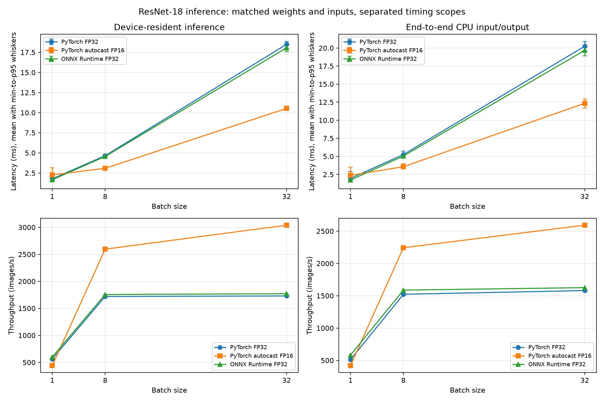

# GPU Inference Optimization Lab

A reproducible inference benchmarking project comparing torchvision ResNet-18 on CPU and an NVIDIA GPU. The lab studies precision, batching, framework overhead, transfer costs, numerical agreement, and benchmark design across three milestones. Measurements below are from this RTX 4060 Laptop run; they are observations, not guarantees for other systems.

## Highlights

- PyTorch CPU FP32 and CUDA FP32 baselines, plus CUDA autocast FP16.
- ONNX Runtime CUDA FP32 using CUDA I/O Binding for device-resident inputs and outputs.
- Matched model weights, deterministic inputs, input shapes, output semantics, warmup, repetitions, and synchronization for GPU comparisons.
- Separate device-resident inference and CPU-input-to-CPU-output request timings.
- Mean, median, p95, throughput, first-call timings, numerical error, top-1 agreement, and PyTorch allocator peak measurements.
- A tiny public-domain/CC0 image smoke set to check preprocessing and expected-label handling.

## Results from this machine

Recorded on Windows with a 13th Gen Intel Core i7-13620H, NVIDIA GeForce RTX 4060 Laptop GPU (8 GB, compute capability 8.9), driver 591.59, Python 3.12.10, PyTorch 2.13.0+cu130, CUDA runtime 13.0, cuDNN 9.2, and ONNX Runtime GPU 1.30.0. The detailed report, numerical comparisons, and protocol are in [Milestone 3 report](results/milestone3/day3_report.md). Day 2 has a [report](results/day2_report.md), [latency chart](results/day2_latency.png), and [throughput chart](results/day2_throughput.png). Raw sample JSON and profiler files are machine-specific and excluded from Git; all measured figures shown here are also summarized in the Markdown reports.

Three independent runs used 10 warmups and 30 timed calls per method, scope, and batch. The table shows aggregate mean latency in milliseconds (throughput in images/second). The scopes are separate: device-resident excludes input/output transfer; end-to-end starts with CPU input and returns CPU logits.

| Batch | Method | Device-resident ms (images/s) | CPU-to-CPU ms (images/s) |
|---:|---|---:|---:|
| 1 | PyTorch CUDA FP32 | 1.7748 (563.43) | 1.9538 (511.82) |
| 1 | PyTorch CUDA autocast FP16 | 2.2682 (440.87) | 2.3810 (420.00) |
| 1 | ONNX Runtime CUDA FP32 | 1.6651 (600.57) | 1.7167 (582.51) |
| 8 | PyTorch CUDA FP32 | 4.6499 (1,720.46) | 5.2544 (1,522.54) |
| 8 | PyTorch CUDA autocast FP16 | 3.0815 (2,596.14) | 3.5663 (2,243.20) |
| 8 | ONNX Runtime CUDA FP32 | 4.5535 (1,756.90) | 5.0402 (1,587.25) |
| 32 | PyTorch CUDA FP32 | 18.4989 (1,729.83) | 20.2419 (1,580.88) |
| 32 | PyTorch CUDA autocast FP16 | 10.5271 (3,039.77) | 12.3470 (2,591.72) |
| 32 | ONNX Runtime CUDA FP32 | 18.0668 (1,771.21) | 19.6811 (1,625.93) |

All checked FP16 and ONNX outputs were `allclose` to PyTorch FP32 at `rtol=0.01`, `atol=0.01`, with 100% top-1 agreement for these benchmark batches. That agreement is not a classification-accuracy measurement. The separate three-image smoke set recorded 3/3 expected-label predictions, which is too small to estimate ImageNet accuracy. FP16 was slower for batch 1 in this run and faster at batches 8 and 32; conclusions are workload- and device-specific.



## Architecture

```text
src/gpu_inference_lab/
  models.py       pretrained ResNet-18 construction
  data.py         deterministic synthetic inputs
  benchmark.py    reusable timing utilities
  environment.py  Python, PyTorch, CUDA, GPU and driver metadata
  cli.py          Day 1 CPU/CUDA FP32 runner
  day2.py         CUDA FP16, ONNX export and Day 2 report runner
  day3.py         matched PyTorch/ONNX CUDA validation and reporting
tests/            CPU-compatible unit tests and conditional CUDA integration tests
scripts/          validation-image fetch helper
data/             validation-set manifest and license/provenance notes
results/          reports and charts; machine-specific raw measurements are local
```

The Day 3 ONNX path disables CPU execution-provider fallback and checks the runtime profile for CUDA node assignments. Device-resident ONNX calls bind the same CUDA input tensor pointer used by PyTorch and let ORT allocate a CUDA output. The report records provider verification and setup costs separately.

## Setup

Use Python 3.12 on Windows. Install a matching PyTorch/torchvision CUDA wheel pair for the driver and runtime available on your machine, then install this project with the Day 3 extras:

```powershell
py -3.12 -m venv .venv
.\.venv\Scripts\python.exe -m pip install --upgrade pip
.\.venv\Scripts\python.exe -m pip install torch==2.13.0 torchvision==0.28.0 --index-url https://download.pytorch.org/whl/cu130
.\.venv\Scripts\python.exe -m pip install numpy==2.5.2 matplotlib==3.11.2 pillow==12.3.0 pytest==9.1.1 onnxruntime-gpu==1.30.0 onnx==1.23.2 onnxscript==0.7.2
.\.venv\Scripts\python.exe -m pip install --no-deps -e .
.\.venv\Scripts\python.exe -c "import torch; print(torch.__version__, torch.version.cuda, torch.cuda.is_available())"
```

These are the package versions used for the recorded run. Install the CUDA wheel pair from the official [PyTorch previous versions instructions](https://pytorch.org/get-started/previous-versions/) and confirm the `cu130` index is available for the selected release. ONNX Runtime GPU must have a compatible CUDA/cuDNN environment; see its [CUDA Execution Provider compatibility matrix](https://onnxruntime.ai/docs/execution-providers/CUDA-ExecutionProvider.html). No separate CUDA toolkit is normally required by PyTorch wheels, but a suitable NVIDIA driver is required. First model use downloads weights from torchvision if they are not cached.

## Reproduce

From the project root in PowerShell, run tests and optionally regenerate each milestone's artifacts:

```powershell
.\.venv\Scripts\python.exe -m pytest
.\.venv\Scripts\python.exe -m gpu_inference_lab.cli --output results/day1_benchmark.json
.\.venv\Scripts\python.exe -m gpu_inference_lab.day2 --output-dir results --runs 3 --warmup-runs 10 --repeats 30
.\.venv\Scripts\python.exe scripts/fetch_validation_images.py
.\.venv\Scripts\python.exe -m gpu_inference_lab.day3 --output-dir results/milestone3 --runs 3 --warmup-runs 10 --repeats 30
```

For CPU-only development/testing, install CPU wheels and the dev extras instead. CUDA-marked tests skip when CUDA is unavailable:

```powershell
py -3.12 -m venv .venv
.\.venv\Scripts\python.exe -m pip install --upgrade pip
.\.venv\Scripts\python.exe -m pip install torch torchvision --index-url https://download.pytorch.org/whl/cpu
.\.venv\Scripts\python.exe -m pip install -e ".[dev]"
.\.venv\Scripts\python.exe -m pytest
```

The report and chart are regenerated alongside JSON, the exported ONNX model, and the ORT profile. Use `--skip-real-images` when you want the benchmark without the optional image validation. On systems with no CUDA, the project unit tests remain runnable; CUDA integration tests skip. Day 3 itself requires CUDA because its goal is a three-way GPU comparison.

## Measurement methodology

- Every method uses the same pretrained ResNet-18 weights, deterministic float32 NCHW values of shape `(N, 3, 224, 224)`, batches 1/8/32, and 1000 float32 logits without softmax. FP16 uses CUDA autocast around the same FP32 model.
- Calls run under `torch.inference_mode()`. Each configuration and independent run has its own first-call measurement and warmups. Timed samples use host wall-clock time with CUDA synchronization around completion.
- Device-resident timing begins after inputs are allocated on CUDA and excludes transfers. End-to-end timing begins with the shared CPU tensor and ends with CPU logits, including transfers and allocation. ONNX's `session.run` is used for that CPU-I/O scope; ONNX I/O Binding is used for the separate device-resident scope. Do not compare values across these scopes as if they measured the same work.
- Throughput is batch size divided by mean call latency. p95 and all individual samples are preserved in the generated result JSON. Model loading, ONNX export/session setup, I/O binding setup, first calls, and standalone H2D transfer measurements are separately recorded.
- Output checks compare numerical errors, tolerance-based `allclose`, and argmax/top-1 agreement against PyTorch FP32. Agreement does not establish correctness against labels. The tiny labeled image set is a preprocessing smoke test only.
- PyTorch peak allocated memory is measured through the PyTorch caching allocator. It excludes CUDA context and allocations owned by other libraries. ONNX Runtime allocates from its own GPU memory pool, so its peak cannot be inferred from PyTorch's counter; the report does not present these values as comparable.
- Results depend on GPU clocks, power and thermal state, driver/runtime versions, background work, and CPU scheduling. Rerun several times on the target system before drawing conclusions.

## Limitations and next steps

The synthetic benchmark does not model image decoding, application batching policy, concurrent requests, or service-level tail latency. The real-image set contains only three examples and cannot support an accuracy claim. The measurements are from one laptop and one software stack. TensorRT and FP16 ONNX are outside the current scope. Raw JSON, model exports, and profiler traces are excluded from Git because they are machine-specific or large; reproducible Markdown summaries and charts are included.

## License and attribution

Original project code is licensed under the [MIT License](LICENSE). Pretrained TorchVision weights may carry terms associated with their training data; see [Third-party notices](THIRD_PARTY_NOTICES.md) and TorchVision's [pretrained weights notice](https://docs.pytorch.org/vision/stable/models.html). Demo image creators, source pages, and licenses are documented in [`data/real_validation/manifest.json`](data/real_validation/manifest.json) and [the image set notes](data/real_validation/README.md). This project license does not relicense third-party weights, datasets, dependencies, or images.

## Git status

The canonical project root is this directory, which contains `pyproject.toml`, `src/`, `tests/`, and `results/`. Git is initialized locally on `main`. No remote repository has been configured and no publication has occurred.
