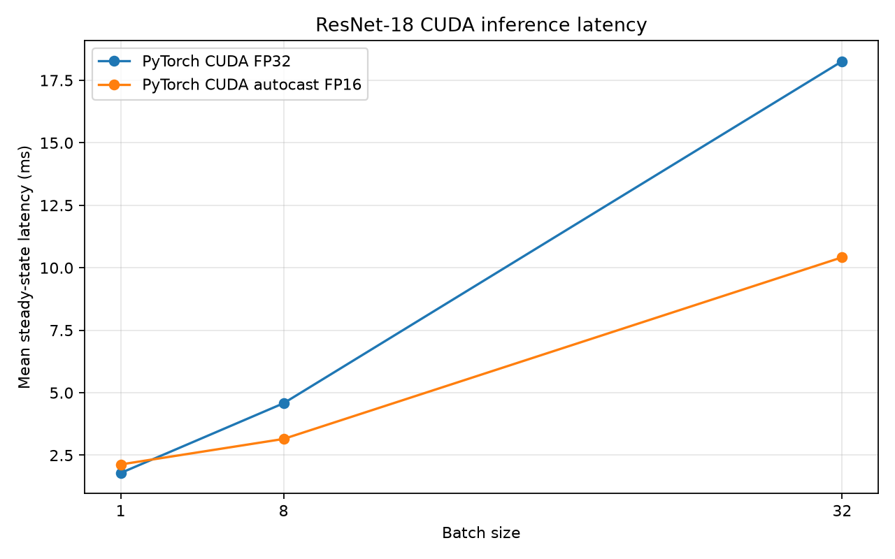
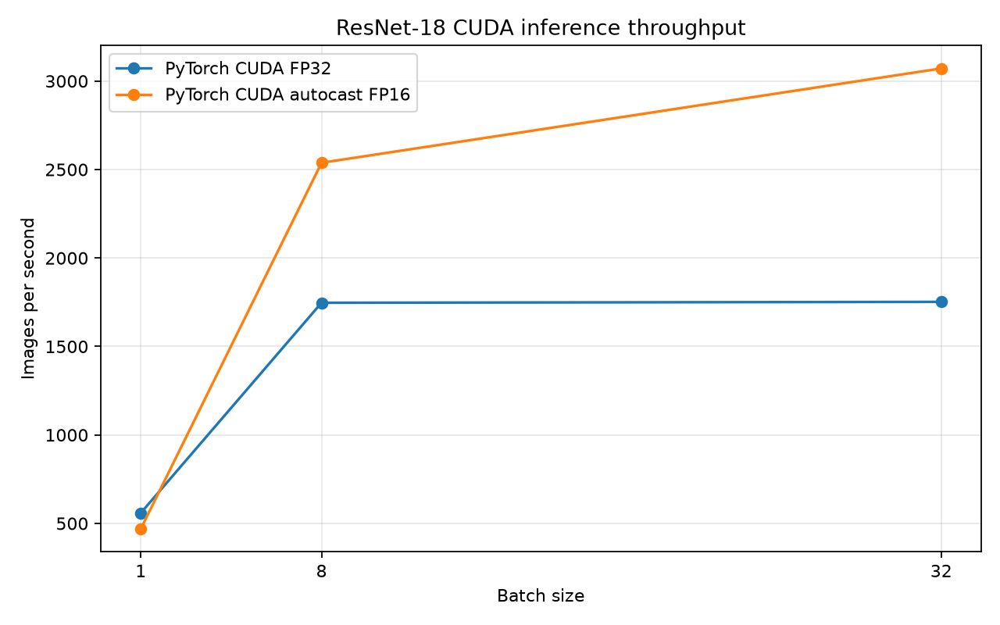

# Day 2 Inference Benchmark Report

Generated: `2026-11-05T18:21:17.319589+00:00`

## Environment

- Python: `3.12.10` (`C:\Users\gpupi\Desktop\Projects Git\GPU Inference Optimization Lab\GPU Optimization  Repo\GPU Inference Optimization Repo\.venv\Scripts\python.exe`)
- Working directory: `C:\Users\gpupi\Desktop\Projects Git\GPU Inference Optimization Lab\GPU Optimization  Repo\GPU Inference Optimization Repo`; Git root: `not present`
- PyTorch: `2.13.0+cu130`; CUDA build `13.0`
- GPU: `NVIDIA GeForce RTX 4060 Laptop GPU`; compute capability `8.9`
- CPU: `13th Gen Intel(R) Core(TM) i7-13620H`; PyTorch threads `10`
- Driver: `591.59`
- Protocol: 3 runs, 10 warmups and 30 timed calls per run/configuration.

## PyTorch CUDA Results

FP32 and autocast FP16 use the same FP32 model weights and deterministic inputs. These figures time only a model call with the input already on CUDA and output left on CUDA; host-to-device transfer is measured separately.

| Precision | Batch | Mean ms | Median ms | p95 ms | Throughput images/s | Peak allocated MiB | FP16 vs FP32 allclose | Top-1 agreement |
|---|---:|---:|---:|---:|---:|---:|---:|---:|
| cuda_fp32 | 1 | 1.7890 | 1.7248 | 2.1167 | 558.97 | 63.10 | — | — |
| cuda_autocast_fp16 | 1 | 2.1310 | 2.0642 | 2.5088 | 469.27 | 62.85 | True | 1.000 |
| cuda_fp32 | 8 | 4.5792 | 4.5361 | 4.8073 | 1747.04 | 106.47 | — | — |
| cuda_autocast_fp16 | 8 | 3.1519 | 3.0075 | 3.6060 | 2538.14 | 87.92 | True | 1.000 |
| cuda_fp32 | 32 | 18.2634 | 18.2462 | 18.6193 | 1752.14 | 267.43 | — | — |
| cuda_autocast_fp16 | 32 | 10.4189 | 10.3498 | 10.6981 | 3071.35 | 190.79 | True | 1.000 |

## Observed FP16 Tradeoff

Percentages below compare this run's FP16 autocast result with CUDA FP32. Lower latency is better; measurements reflect this GPU and this synthetic input workload.

| Batch | Mean latency change | Throughput change | Peak allocated memory change |
|---:|---:|---:|---:|
| 1 | 19.1% slower | -16.0% | -0.4% |
| 8 | 31.2% lower | +45.3% | -17.4% |
| 32 | 43.0% lower | +75.3% | -28.7% |





## Transfer, startup, and numerical details

- **cuda_fp32 batch 1**: separate H2D transfer mean 0.0925 ms, median 0.0928 ms, p95 0.0980 ms.
  First-forward per run: 121.2998, 1.9338, 1.7754 ms. FP32 model initialization: 0.1816 s (shared across precision configurations).
- **cuda_autocast_fp16 batch 1**: separate H2D transfer mean 0.0925 ms, median 0.0928 ms, p95 0.0980 ms.
  First-forward per run: 140.2447, 2.0652, 2.2228 ms. FP32 model initialization: 0.1816 s (shared across precision configurations).
  FP16 numerical check: allclose=True with rtol=0.01, atol=0.01; max abs error=0.0029521; mean abs error=0.000657255; RMSE=0.000832807; max relative error=1.16034.
- **cuda_fp32 batch 8**: separate H2D transfer mean 0.4598 ms, median 0.4509 ms, p95 0.4681 ms.
  First-forward per run: 26.3497, 4.5236, 4.5444 ms. FP32 model initialization: 0.1816 s (shared across precision configurations).
- **cuda_autocast_fp16 batch 8**: separate H2D transfer mean 0.4598 ms, median 0.4509 ms, p95 0.4681 ms.
  First-forward per run: 22.6626, 2.9575, 2.9785 ms. FP32 model initialization: 0.1816 s (shared across precision configurations).
  FP16 numerical check: allclose=True with rtol=0.01, atol=0.01; max abs error=0.00710988; mean abs error=0.00124348; RMSE=0.00156441; max relative error=62.8495.
- **cuda_fp32 batch 32**: separate H2D transfer mean 1.8258 ms, median 1.7081 ms, p95 2.5178 ms.
  First-forward per run: 25.1159, 17.9648, 18.0359 ms. FP32 model initialization: 0.1816 s (shared across precision configurations).
- **cuda_autocast_fp16 batch 32**: separate H2D transfer mean 1.8258 ms, median 1.7081 ms, p95 2.5178 ms.
  First-forward per run: 24.3782, 10.3708, 10.3783 ms. FP32 model initialization: 0.1816 s (shared across precision configurations).
  FP16 numerical check: allclose=True with rtol=0.01, atol=0.01; max abs error=0.00621223; mean abs error=0.00091551; RMSE=0.00117907; max relative error=168.273.

## ONNX Runtime CUDA

ONNX Runtime `1.30.0` active providers: `['CUDAExecutionProvider', 'CPUExecutionProvider']`; profile provider assignments: `{'CUDAExecutionProvider': 17787}`. CPU fallback was disabled and the profile contained CUDA nodes only.
Timing is ONNX `session.run`, including CPU input handling, H2D transfer, graph execution and D2H output copy. It is an end-to-end request measurement and is not directly comparable to the PyTorch device-resident forward-only figures above.
Versions: ONNX `1.23.2`, ONNX Script `0.7.2`. DLL preload: 0.0011 s; ONNX session initialization: 0.0948 s; model export: 2.6034 s (all excluded from steady-state timing).

| Batch | First session run ms | Mean ms | Median ms | p95 ms | Throughput images/s | Allclose | Top-1 agreement vs PyTorch FP32 |
|---:|---:|---:|---:|---:|---:|:---:|---:|
| 1 | 110.2220 | 2.9513 | 2.0889 | 4.9819 | 338.84 | True | 1.000 |
| 8 | 26.5607 | 4.7852 | 4.7396 | 5.1144 | 1671.82 | True | 1.000 |
| 32 | 30.2784 | 19.2237 | 19.1167 | 19.9209 | 1664.61 | True | 1.000 |

Dynamo ONNX export time: 2.603 s (excluded from inference timing); profile file: `results\onnxruntime_profile_2026-11-05_13-21-25_502.json`.

## Interpretation and limitations

These are observed measurements, not guaranteed improvements. FP16 autocast retains FP32 model parameters and selects reduced precision for eligible CUDA operations. A speedup is shape-, hardware-, clock-, and workload-dependent; small batch latency can be launch/dispatch bound. Relative error can look large for logits close to zero; the allclose check also applies the stated absolute tolerance. Peak allocation is measured through PyTorch's allocator and does not include all driver or context memory. Synthetic random inputs represent tensor shape and dtype, not image preprocessing or production traffic. Independent runs share one process/model and are not cold process launches.

## Reproduce

```powershell
.\.venv\Scripts\python.exe -m pytest
.\.venv\Scripts\python.exe -m gpu_inference_lab.day2 --output-dir results --runs 3 --warmup-runs 10 --repeats 30
```
