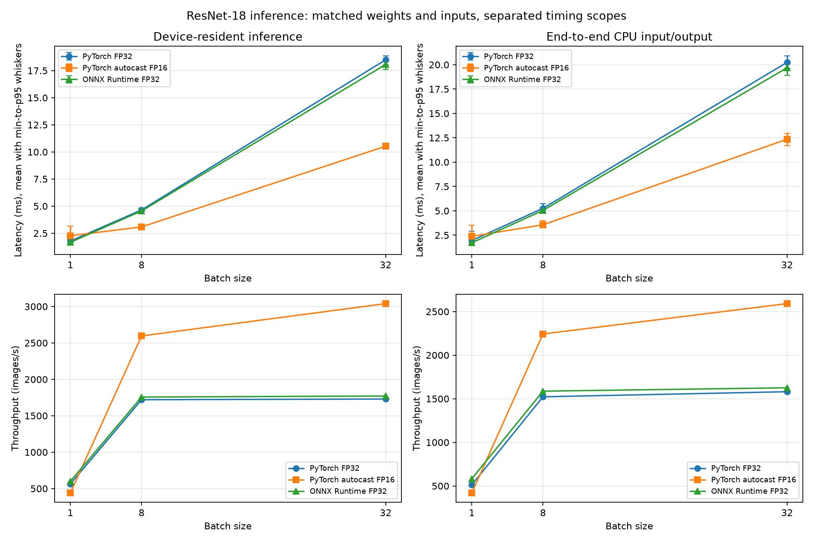

# GPU Inference Optimization Lab — Milestone 3

Run timestamp (UTC): `2026-11-05T18:56:06.341166+00:00`

## Environment and protocol

- Python: `3.12.10`; executable `python.exe`
- PyTorch: `2.13.0+cu130`; CUDA build `13.0`; cuDNN `92000`
- GPU: `NVIDIA GeForce RTX 4060 Laptop GPU` (8187 MiB, CC 8.9)
- CPU: `13th Gen Intel(R) Core(TM) i7-13620H`; driver `591.59`
- Git root: `GPU Inference Optimization Repo`
- Runs: 3; warmups per run/configuration: 10; timed calls per run/configuration: 30.
- Model initialization, ONNX export, ONNX session initialization, first calls, steady-state samples, and standalone H2D copies are separate fields in the JSON.

All inference methods use one pretrained ResNet-18 checkpoint, the same fixed-seed float32 NCHW input values, batch sizes 1/8/32, and 1000-class float32 logits with no softmax. CUDA execution is synchronized before and after each timed sample.

## Matched-scope comparison

Device-resident timings exclude input and output transfers. PyTorch receives an existing CUDA tensor; ONNX Runtime uses I/O Binding with that same CUDA tensor pointer and an ORT-allocated CUDA output. End-to-end timings start with the same CPU tensor and finish with CPU logits; PyTorch explicitly copies input and output, while ONNX uses `session.run` and its CPU I/O path.

### Device-resident inference

| Method | Batch | Mean ms | Median ms | p95 ms | Images/s | PyTorch peak allocated MiB |
|---|---:|---:|---:|---:|---:|---:|
| PyTorch FP32 (device-resident) | 1 | 1.7748 | 1.7530 | 1.9635 | 563.43 | 63.09 |
| PyTorch autocast FP16 (device-resident) | 1 | 2.2682 | 2.1330 | 3.1744 | 440.87 | 62.86 |
| ONNX Runtime FP32 I/O Binding (device-resident) | 1 | 1.6651 | 1.5562 | 2.3383 | 600.57 | not visible to torch allocator |
| PyTorch FP32 (device-resident) | 8 | 4.6499 | 4.5958 | 4.8527 | 1720.46 | 106.44 |
| PyTorch autocast FP16 (device-resident) | 8 | 3.0815 | 3.0439 | 3.3383 | 2596.14 | 87.94 |
| ONNX Runtime FP32 I/O Binding (device-resident) | 8 | 4.5535 | 4.5323 | 4.7879 | 1756.90 | not visible to torch allocator |
| PyTorch FP32 (device-resident) | 32 | 18.4989 | 18.4716 | 18.8704 | 1729.83 | 267.31 |
| PyTorch autocast FP16 (device-resident) | 32 | 10.5271 | 10.5011 | 10.7955 | 3039.77 | 190.85 |
| ONNX Runtime FP32 I/O Binding (device-resident) | 32 | 18.0668 | 18.0841 | 18.3669 | 1771.21 | not visible to torch allocator |

### End-to-end CPU input to CPU output

| Method | Batch | Mean ms | Median ms | p95 ms | Images/s | PyTorch peak allocated MiB |
|---|---:|---:|---:|---:|---:|---:|
| PyTorch FP32 (CPU input to CPU output) | 1 | 1.9538 | 1.8348 | 2.8881 | 511.82 | 63.09 |
| PyTorch autocast FP16 (CPU input to CPU output) | 1 | 2.3810 | 2.2670 | 3.4957 | 420.00 | 62.85 |
| ONNX Runtime FP32 session.run (CPU input to CPU output) | 1 | 1.7167 | 1.6498 | 2.0876 | 582.51 | not visible to torch allocator |
| PyTorch FP32 (CPU input to CPU output) | 8 | 5.2544 | 5.1598 | 5.7191 | 1522.54 | 106.42 |
| PyTorch autocast FP16 (CPU input to CPU output) | 8 | 3.5663 | 3.5118 | 3.9825 | 2243.20 | 87.89 |
| ONNX Runtime FP32 session.run (CPU input to CPU output) | 8 | 5.0402 | 5.0185 | 5.2842 | 1587.25 | not visible to torch allocator |
| PyTorch FP32 (CPU input to CPU output) | 32 | 20.2419 | 20.1230 | 20.9191 | 1580.88 | 267.25 |
| PyTorch autocast FP16 (CPU input to CPU output) | 32 | 12.3470 | 12.2381 | 12.9711 | 2591.72 | 190.67 |
| ONNX Runtime FP32 session.run (CPU input to CPU output) | 32 | 19.6811 | 19.5451 | 20.2237 | 1625.93 | not visible to torch allocator |



## Output comparison

Prediction agreement compares argmax classes; it is distinct from numerical closeness. `allclose` uses rtol=0.01 and atol=0.01.

| Scope | Batch | Method vs PyTorch FP32 | Allclose | Max absolute error | Mean absolute error | RMSE | Top-1 agreement |
|---|---:|---|:---:|---:|---:|---:|---:|
| device_resident | 1 | pytorch_fp16 | True | 0.0029521 | 0.000657255 | 0.000832807 | 100.0% |
| device_resident | 1 | onnx_fp32 | True | 0.00584006 | 0.00126981 | 0.00159133 | 100.0% |
| end_to_end | 1 | pytorch_fp16 | True | 0.0029521 | 0.000657255 | 0.000832807 | 100.0% |
| end_to_end | 1 | onnx_fp32 | True | 0.00584006 | 0.00126981 | 0.00159133 | 100.0% |
| device_resident | 8 | pytorch_fp16 | True | 0.00710988 | 0.00124348 | 0.00156441 | 100.0% |
| device_resident | 8 | onnx_fp32 | True | 0.00539821 | 0.000833739 | 0.00104965 | 100.0% |
| end_to_end | 8 | pytorch_fp16 | True | 0.00710988 | 0.00124348 | 0.00156441 | 100.0% |
| end_to_end | 8 | onnx_fp32 | True | 0.00539821 | 0.000833739 | 0.00104965 | 100.0% |
| device_resident | 32 | pytorch_fp16 | True | 0.00621223 | 0.00091551 | 0.00117907 | 100.0% |
| device_resident | 32 | onnx_fp32 | True | 0.00809288 | 0.00121538 | 0.00156692 | 100.0% |
| end_to_end | 32 | pytorch_fp16 | True | 0.00621223 | 0.00091551 | 0.00117907 | 100.0% |
| end_to_end | 32 | onnx_fp32 | True | 0.00809288 | 0.00121538 | 0.00156692 | 100.0% |

## ONNX CUDA and memory accounting

ORT `1.30.0` providers: `['CUDAExecutionProvider', 'CPUExecutionProvider']`. CPU fallback disabled: `True`. Profile assignment counts: `{'CUDAExecutionProvider': 36211}`. CUDA-only profile verification: `True`.

PyTorch peak allocated bytes report only the PyTorch caching allocator. ONNX Runtime allocates CUDA memory outside this counter; ORT peak GPU allocation is not claimed or compared.

## Real-image smoke validation

Set: `small-public-domain-animal-validation` (3 images). Prediction agreement and top-1 accuracy are different measurements:
- FP16 agreement with PyTorch FP32: 100.0%; exact-label accuracy on this tiny subset: 100.0%.
- ONNX CUDA agreement with PyTorch FP32: 100.0%; exact-label accuracy on this tiny subset: 100.0%.

| Image | Expected label | PyTorch FP32 prediction | FP16 prediction | ONNX prediction |
|---|---|---|---|---|
| labrador_dog.jpg | Labrador retriever | Labrador retriever | Labrador retriever | Labrador retriever |
| tabby_cat.jpg | tabby cat | tabby | tabby | tabby |
| goldfish.jpg | goldfish | goldfish | goldfish | goldfish |

This three-image public-domain/CC0 smoke set checks preprocessing and semantic output flow only. It is not a meaningful estimate of ImageNet accuracy. Image sources and license evidence are listed in `data/real_validation/README.md`.

## Interpretation and limitations

Use device-resident comparisons to study framework/model execution; use end-to-end comparisons to study a CPU-fed, CPU-consumed request. The I/O Binding output allocation is owned by ONNX Runtime. PyTorch peak allocated memory omits ORT's CUDA allocator, CUDA context, and other non-PyTorch allocations, so there is no directly comparable ORT peak number here. The small batch-one path can be dispatch-bound. Results are specific to this laptop, driver, thermal/power state, software versions, and synthetic benchmark inputs. No performance improvement is assumed; inspect the recorded distributions.

## Reproduce

```powershell
.\.venv\Scripts\python.exe -m pytest
.\.venv\Scripts\python.exe scripts/fetch_validation_images.py
.\.venv\Scripts\python.exe -m gpu_inference_lab.day3 --output-dir results/milestone3 --runs 3 --warmup-runs 10 --repeats 30
```
